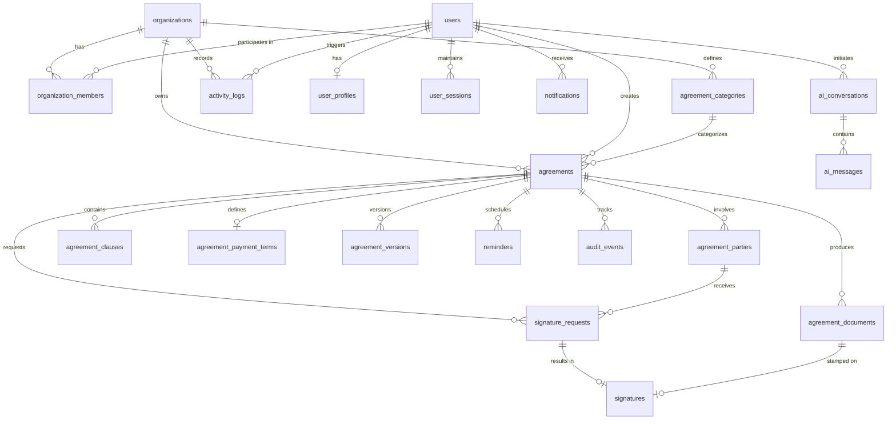

# AGREE2MET — Relational Database Design & Schema Specification

**Document Version:** 1.0.0  
**Phase:** Phase 0 — Database Architecture & Data Modeling  
**Target RDBMS:** PostgreSQL 16+  
**ORM:** Prisma ORM 5.x  
**Status:** Draft — Awaiting User Approval  

---

## 1. Data Modeling Strategy & Design Principles

The Agree2Met database is modeled in **Third Normal Form (3NF)** with strategic denormalization (such as computed status counters and pre-calculated hash digests) to balance ACID consistency with sub-100ms dashboard retrieval performance.

### Core Architecture Rules:
1. **Multi-Tenancy Isolation:** Organizations relate to users exclusively through `organization_members`. All tenant-scoped entities include `organization_id` foreign keys indexed for high-selectivity filtering.
2. **Audit Immutability:** Event and signing tables (`audit_events`, `signatures`, `agreement_versions`) are append-only. `audit_events.agreement_id` is set to `ON DELETE RESTRICT` to prevent accidental loss of audit history. Agreements with audit events cannot be deleted; they must be archived.
3. **Cryptographic Chaining:** Each record in `audit_events` references the SHA-256 hash of the preceding event, creating a tamper-evident audit trail for every agreement.
4. **Hashed Token Storage:** Email verification tokens, password reset tokens, refresh tokens, and signing invitation tokens are stored strictly as SHA-256 hashes (`verification_token_hash`, `password_reset_token_hash`, `refresh_token_hash`, `invitation_token_hash`), never in plaintext.
5. **UUID Primary Keys:** All primary keys utilize high-entropy UUIDv4 strings using PostgreSQL `gen_random_uuid()` consistently across all tables.

---

## 2. Entity-Relationship Diagram (Mermaid)



---

## 3. Detailed Relational Schema Specifications (20 Application Tables)

### 3.1 Identity, Workspace & Session Tables

#### Table 1: `organizations`
Represents customer organizations, company accounts, or personal default workspaces.
```sql
CREATE TABLE organizations (
    id UUID PRIMARY KEY DEFAULT gen_random_uuid(),
    name VARCHAR(255) NOT NULL,
    slug VARCHAR(255) UNIQUE NOT NULL,
    logo_url TEXT,
    billing_email VARCHAR(255) NOT NULL,
    subscription_tier VARCHAR(50) DEFAULT 'FREE' NOT NULL, -- FREE, PRO, ENTERPRISE
    default_currency VARCHAR(3) DEFAULT 'USD' NOT NULL,
    default_timezone VARCHAR(50) DEFAULT 'UTC' NOT NULL,
    is_active BOOLEAN DEFAULT TRUE NOT NULL,
    created_at TIMESTAMP WITH TIME ZONE DEFAULT CURRENT_TIMESTAMP NOT NULL,
    updated_at TIMESTAMP WITH TIME ZONE DEFAULT CURRENT_TIMESTAMP NOT NULL
);
CREATE INDEX idx_org_slug ON organizations(slug);
```

#### Table 2: `users`
Core authentication and user identity credentials. All sensitive tokens are stored strictly as SHA-256 hashes.
```sql
CREATE TABLE users (
    id UUID PRIMARY KEY DEFAULT gen_random_uuid(),
    email VARCHAR(255) UNIQUE NOT NULL,
    password_hash VARCHAR(255), -- Nullable for OAuth-only users (Argon2id)
    auth_provider VARCHAR(50) DEFAULT 'LOCAL' NOT NULL, -- LOCAL, GOOGLE
    provider_id VARCHAR(255),
    is_email_verified BOOLEAN DEFAULT FALSE NOT NULL,
    verification_token_hash VARCHAR(64), -- SHA-256 hash of random verification token
    verification_token_expires_at TIMESTAMP WITH TIME ZONE,
    password_reset_token_hash VARCHAR(64), -- SHA-256 hash of random reset token
    password_reset_expires_at TIMESTAMP WITH TIME ZONE,
    last_login_at TIMESTAMP WITH TIME ZONE,
    failed_login_attempts INT DEFAULT 0 NOT NULL,
    locked_until TIMESTAMP WITH TIME ZONE,
    created_at TIMESTAMP WITH TIME ZONE DEFAULT CURRENT_TIMESTAMP NOT NULL,
    updated_at TIMESTAMP WITH TIME ZONE DEFAULT CURRENT_TIMESTAMP NOT NULL
);
CREATE INDEX idx_users_email ON users(email);
```

#### Table 3: `user_profiles`
Personal user profile details, avatar storage key, and UI preferences.
```sql
CREATE TABLE user_profiles (
    id UUID PRIMARY KEY DEFAULT gen_random_uuid(),
    user_id UUID UNIQUE NOT NULL REFERENCES users(id) ON DELETE CASCADE,
    first_name VARCHAR(100) NOT NULL,
    last_name VARCHAR(100) NOT NULL,
    display_name VARCHAR(200),
    phone_number VARCHAR(50),
    avatar_url TEXT, -- Private S3 storage path
    job_title VARCHAR(150),
    theme_preference VARCHAR(10) DEFAULT 'system' NOT NULL, -- light, dark, system
    email_notification_preferences JSONB DEFAULT '{"on_signature_requested": true, "on_agreement_signed": true, "on_agreement_completed": true, "on_reminder": true}'::jsonb NOT NULL,
    created_at TIMESTAMP WITH TIME ZONE DEFAULT CURRENT_TIMESTAMP NOT NULL,
    updated_at TIMESTAMP WITH TIME ZONE DEFAULT CURRENT_TIMESTAMP NOT NULL
);
```

#### Table 4: `organization_members`
Association table connecting users to organizations with role-based permissions.
```sql
CREATE TABLE organization_members (
    id UUID PRIMARY KEY DEFAULT gen_random_uuid(),
    organization_id UUID NOT NULL REFERENCES organizations(id) ON DELETE CASCADE,
    user_id UUID NOT NULL REFERENCES users(id) ON DELETE CASCADE,
    role VARCHAR(50) DEFAULT 'MEMBER' NOT NULL, -- OWNER, ADMIN, MEMBER, VIEWER
    is_active BOOLEAN DEFAULT TRUE NOT NULL,
    created_at TIMESTAMP WITH TIME ZONE DEFAULT CURRENT_TIMESTAMP NOT NULL,
    updated_at TIMESTAMP WITH TIME ZONE DEFAULT CURRENT_TIMESTAMP NOT NULL,
    CONSTRAINT uq_org_user UNIQUE (organization_id, user_id)
);
CREATE INDEX idx_org_members_user ON organization_members(user_id);
CREATE INDEX idx_org_members_org_role ON organization_members(organization_id, role);
```

#### Table 5: `user_sessions`
Active login sessions and hashed refresh tokens for session management, token-family rotation, and instant revocation.
```sql
CREATE TABLE user_sessions (
    id UUID PRIMARY KEY DEFAULT gen_random_uuid(),
    user_id UUID NOT NULL REFERENCES users(id) ON DELETE CASCADE,
    refresh_token_hash VARCHAR(64) NOT NULL, -- SHA-256 hash of rolling refresh token
    family_id UUID DEFAULT gen_random_uuid() NOT NULL, -- Token family identifier for reuse detection
    user_agent TEXT,
    ip_address VARCHAR(45),
    is_revoked BOOLEAN DEFAULT FALSE NOT NULL,
    expires_at TIMESTAMP WITH TIME ZONE NOT NULL,
    created_at TIMESTAMP WITH TIME ZONE DEFAULT CURRENT_TIMESTAMP NOT NULL,
    updated_at TIMESTAMP WITH TIME ZONE DEFAULT CURRENT_TIMESTAMP NOT NULL
);
CREATE INDEX idx_sessions_user ON user_sessions(user_id);
CREATE INDEX idx_sessions_refresh_hash ON user_sessions(refresh_token_hash);
CREATE INDEX idx_sessions_family_id ON user_sessions(family_id);
```

#### Table 5B: `organization_invitations`
Pending and historical invitations for inviting collaborators to organizations. All invitation tokens are stored as SHA-256 hashes.
```sql
CREATE TABLE organization_invitations (
    id UUID PRIMARY KEY DEFAULT gen_random_uuid(),
    organization_id UUID NOT NULL REFERENCES organizations(id) ON DELETE CASCADE,
    email VARCHAR(255) NOT NULL,
    role VARCHAR(50) DEFAULT 'MEMBER' NOT NULL, -- OWNER, ADMIN, MEMBER, VIEWER
    invitation_token_hash VARCHAR(64) NOT NULL, -- SHA-256 hash of secret invitation token
    invited_by UUID NOT NULL REFERENCES users(id) ON DELETE CASCADE,
    status VARCHAR(50) DEFAULT 'PENDING' NOT NULL, -- PENDING, ACCEPTED, REVOKED, EXPIRED
    expires_at TIMESTAMP WITH TIME ZONE NOT NULL,
    accepted_at TIMESTAMP WITH TIME ZONE,
    created_at TIMESTAMP WITH TIME ZONE DEFAULT CURRENT_TIMESTAMP NOT NULL
);
CREATE INDEX idx_org_invitations_org ON organization_invitations(organization_id);
CREATE INDEX idx_org_invitations_email ON organization_invitations(email);
CREATE INDEX idx_org_invitations_token_hash ON organization_invitations(invitation_token_hash);
```

---

### 3.2 Agreement Domain Tables

#### Table 6: `agreement_categories`
System and tenant-customized categories for agreements.
```sql
CREATE TABLE agreement_categories (
    id UUID PRIMARY KEY DEFAULT gen_random_uuid(),
    organization_id UUID REFERENCES organizations(id) ON DELETE CASCADE, -- NULL for system defaults
    name VARCHAR(100) NOT NULL,
    slug VARCHAR(100) NOT NULL,
    description TEXT,
    icon_name VARCHAR(50) DEFAULT 'FileText' NOT NULL,
    is_system_default BOOLEAN DEFAULT FALSE NOT NULL,
    created_at TIMESTAMP WITH TIME ZONE DEFAULT CURRENT_TIMESTAMP NOT NULL
);
CREATE UNIQUE INDEX uq_org_category_slug ON agreement_categories(COALESCE(organization_id, '00000000-0000-0000-0000-000000000000'), slug);
```

#### Table 7: `agreements`
The primary agreement entity governing contract state, ownership, and lifecycle.
```sql
CREATE TABLE agreements (
    id UUID PRIMARY KEY DEFAULT gen_random_uuid(),
    reference_number VARCHAR(100) NOT NULL, -- e.g. A2M-2026-0001
    organization_id UUID NOT NULL REFERENCES organizations(id) ON DELETE RESTRICT,
    creator_id UUID NOT NULL REFERENCES users(id) ON DELETE RESTRICT,
    category_id UUID NOT NULL REFERENCES agreement_categories(id) ON DELETE RESTRICT,
    title VARCHAR(300) NOT NULL,
    description TEXT,
    status VARCHAR(50) DEFAULT 'DRAFT' NOT NULL,
    -- Status Enum: DRAFT, PENDING_REVIEW, SENT, AWAITING_SIGNATURES, PARTIALLY_SIGNED, COMPLETED, REJECTED, CANCELLED, EXPIRED
    signing_order VARCHAR(20) DEFAULT 'PARALLEL' NOT NULL, -- PARALLEL, SEQUENTIAL
    current_signer_sequence INT DEFAULT 1 NOT NULL,
    total_signers_count INT DEFAULT 0 NOT NULL,
    completed_signers_count INT DEFAULT 0 NOT NULL,
    effective_date DATE,
    expiration_date DATE,
    completed_at TIMESTAMP WITH TIME ZONE,
    cancelled_at TIMESTAMP WITH TIME ZONE,
    cancellation_reason TEXT,
    rejection_reason TEXT,
    is_archived BOOLEAN DEFAULT FALSE NOT NULL,
    created_at TIMESTAMP WITH TIME ZONE DEFAULT CURRENT_TIMESTAMP NOT NULL,
    updated_at TIMESTAMP WITH TIME ZONE DEFAULT CURRENT_TIMESTAMP NOT NULL,
    CONSTRAINT uq_org_reference UNIQUE (organization_id, reference_number)
);
CREATE INDEX idx_agreements_org_status ON agreements(organization_id, status);
CREATE INDEX idx_agreements_creator ON agreements(creator_id);
CREATE INDEX idx_agreements_expiration ON agreements(expiration_date) WHERE status IN ('SENT', 'AWAITING_SIGNATURES', 'PARTIALLY_SIGNED');
CREATE INDEX idx_agreements_search ON agreements USING GIN (to_tsvector('english', title || ' ' || reference_number));
```

#### Table 8: `agreement_parties`
Entities and individuals participating in the agreement.
```sql
CREATE TABLE agreement_parties (
    id UUID PRIMARY KEY DEFAULT gen_random_uuid(),
    agreement_id UUID NOT NULL REFERENCES agreements(id) ON DELETE CASCADE,
    party_type VARCHAR(50) DEFAULT 'COUNTERPARTY' NOT NULL, -- INITIATOR, COUNTERPARTY, WITNESS
    name VARCHAR(255) NOT NULL,
    company_name VARCHAR(255),
    email VARCHAR(255) NOT NULL,
    phone VARCHAR(50),
    role VARCHAR(50) DEFAULT 'SIGNER' NOT NULL, -- SIGNER, REVIEWER, VIEWER
    signing_sequence INT DEFAULT 1 NOT NULL, -- Order in sequential signing
    status VARCHAR(50) DEFAULT 'PENDING' NOT NULL, -- PENDING, INVITED, VIEWED, SIGNED, REJECTED
    signed_at TIMESTAMP WITH TIME ZONE,
    created_at TIMESTAMP WITH TIME ZONE DEFAULT CURRENT_TIMESTAMP NOT NULL,
    updated_at TIMESTAMP WITH TIME ZONE DEFAULT CURRENT_TIMESTAMP NOT NULL
);
CREATE INDEX idx_agreement_parties_agreement ON agreement_parties(agreement_id);
CREATE INDEX idx_agreement_parties_email ON agreement_parties(email);
```

#### Table 9: `agreement_clauses`
Normalized structured contract terms and legal clauses.
```sql
CREATE TABLE agreement_clauses (
    id UUID PRIMARY KEY DEFAULT gen_random_uuid(),
    agreement_id UUID NOT NULL REFERENCES agreements(id) ON DELETE CASCADE,
    section_number VARCHAR(20) NOT NULL, -- e.g. "1.0", "1.1", "2.0"
    title VARCHAR(300) NOT NULL,
    content TEXT NOT NULL,
    is_standard_clause BOOLEAN DEFAULT TRUE NOT NULL,
    is_mandatory BOOLEAN DEFAULT TRUE NOT NULL,
    display_order INT NOT NULL,
    created_at TIMESTAMP WITH TIME ZONE DEFAULT CURRENT_TIMESTAMP NOT NULL,
    updated_at TIMESTAMP WITH TIME ZONE DEFAULT CURRENT_TIMESTAMP NOT NULL
);
CREATE INDEX idx_clauses_agreement_order ON agreement_clauses(agreement_id, display_order);
```

#### Table 10: `agreement_payment_terms`
Structured financial and commercial terms associated with an agreement.
```sql
CREATE TABLE agreement_payment_terms (
    id UUID PRIMARY KEY DEFAULT gen_random_uuid(),
    agreement_id UUID UNIQUE NOT NULL REFERENCES agreements(id) ON DELETE CASCADE,
    total_amount NUMERIC(14, 2),
    currency VARCHAR(3) DEFAULT 'USD' NOT NULL,
    payment_schedule VARCHAR(50) DEFAULT 'MILESTONE', -- LUMP_SUM, MONTHLY, MILESTONE, NET_30, NET_60
    billing_notes TEXT,
    milestones JSONB DEFAULT '[]'::jsonb NOT NULL,
    created_at TIMESTAMP WITH TIME ZONE DEFAULT CURRENT_TIMESTAMP NOT NULL,
    updated_at TIMESTAMP WITH TIME ZONE DEFAULT CURRENT_TIMESTAMP NOT NULL
);
```

---

### 3.3 Document, Versioning & Signing Tables

#### Table 11: `agreement_versions`
Snapshot version tracking for drafted or revised agreements (introduced basically in Phase 5, extended in Phase 10).
```sql
CREATE TABLE agreement_versions (
    id UUID PRIMARY KEY DEFAULT gen_random_uuid(),
    agreement_id UUID NOT NULL REFERENCES agreements(id) ON DELETE CASCADE,
    version_number INT NOT NULL,
    snapshot_payload JSONB NOT NULL, -- Full JSON representation of clauses, parties, payment terms
    created_by UUID NOT NULL REFERENCES users(id),
    change_summary VARCHAR(500),
    created_at TIMESTAMP WITH TIME ZONE DEFAULT CURRENT_TIMESTAMP NOT NULL,
    CONSTRAINT uq_agreement_version UNIQUE (agreement_id, version_number)
);
```

#### Table 12: `agreement_documents`
Binary artifacts (compiled PDFs) generated for preview, dispatch, and final archive.
```sql
CREATE TABLE agreement_documents (
    id UUID PRIMARY KEY DEFAULT gen_random_uuid(),
    agreement_id UUID NOT NULL REFERENCES agreements(id) ON DELETE CASCADE,
    document_type VARCHAR(50) NOT NULL, -- PREVIEW, SENT_ORIGINAL, EXECUTED_SEALED, AUDIT_CERTIFICATE, ATTACHMENT
    storage_path TEXT NOT NULL, -- Private S3 storage key
    file_name VARCHAR(255) NOT NULL,
    mime_type VARCHAR(100) DEFAULT 'application/pdf' NOT NULL,
    file_size_bytes BIGINT NOT NULL,
    sha256_checksum VARCHAR(64) NOT NULL, -- Integrity hash
    version_number INT DEFAULT 1 NOT NULL,
    created_at TIMESTAMP WITH TIME ZONE DEFAULT CURRENT_TIMESTAMP NOT NULL
);
CREATE INDEX idx_documents_agreement ON agreement_documents(agreement_id);
```

#### Table 13: `signature_requests`
Tokens and access credentials issued to signers. Plaintext tokens are transmitted only in email links; only the SHA-256 hash is persisted.
```sql
CREATE TABLE signature_requests (
    id UUID PRIMARY KEY DEFAULT gen_random_uuid(),
    agreement_id UUID NOT NULL REFERENCES agreements(id) ON DELETE CASCADE,
    party_id UUID UNIQUE NOT NULL REFERENCES agreement_parties(id) ON DELETE CASCADE,
    invitation_token_hash VARCHAR(64) UNIQUE NOT NULL, -- SHA-256 hash of random signing token
    access_code_hash VARCHAR(64), -- Optional SHA-256 hash of OTP code
    expires_at TIMESTAMP WITH TIME ZONE NOT NULL,
    viewed_at TIMESTAMP WITH TIME ZONE,
    status VARCHAR(50) DEFAULT 'PENDING' NOT NULL, -- PENDING, VIEWED, SIGNED, DECLINED, EXPIRED
    decline_reason TEXT,
    created_at TIMESTAMP WITH TIME ZONE DEFAULT CURRENT_TIMESTAMP NOT NULL,
    updated_at TIMESTAMP WITH TIME ZONE DEFAULT CURRENT_TIMESTAMP NOT NULL
);
CREATE INDEX idx_signature_requests_hash ON signature_requests(invitation_token_hash);
CREATE INDEX idx_signature_requests_agreement ON signature_requests(agreement_id);
```

#### Table 14: `signatures`
Electronic signature records and evidentiary metadata.
```sql
CREATE TABLE signatures (
    id UUID PRIMARY KEY DEFAULT gen_random_uuid(),
    signature_request_id UUID UNIQUE NOT NULL REFERENCES signature_requests(id) ON DELETE RESTRICT,
    agreement_id UUID NOT NULL REFERENCES agreements(id) ON DELETE RESTRICT,
    party_id UUID NOT NULL REFERENCES agreement_parties(id) ON DELETE RESTRICT,
    signer_name VARCHAR(255) NOT NULL,
    signer_email VARCHAR(255) NOT NULL,
    signature_type VARCHAR(50) NOT NULL, -- DRAWN, TYPED, UPLOADED
    signature_image_path TEXT, -- S3 path to vector or raster signature
    typed_signature_text VARCHAR(255),
    ip_address VARCHAR(45) NOT NULL, -- IPv4 or IPv6
    user_agent TEXT NOT NULL,
    consent_acknowledged BOOLEAN DEFAULT TRUE NOT NULL,
    consent_statement TEXT NOT NULL,
    document_hash_at_signing VARCHAR(64) NOT NULL, -- SHA-256 of document when signed
    signed_at TIMESTAMP WITH TIME ZONE DEFAULT CURRENT_TIMESTAMP NOT NULL
);
CREATE INDEX idx_signatures_agreement ON signatures(agreement_id);
```

---

### 3.4 Audit Trail, Logs & Notifications

#### Table 15: `audit_events`
Tamper-evident, cryptographically chained audit record. Uses `ON DELETE RESTRICT` to preserve immutability.
```sql
CREATE TABLE audit_events (
    id UUID PRIMARY KEY DEFAULT gen_random_uuid(),
    agreement_id UUID NOT NULL REFERENCES agreements(id) ON DELETE RESTRICT, -- RESTRICT prevents deletion of agreements with audit logs
    event_type VARCHAR(100) NOT NULL, 
    -- e.g., CREATED, UPDATED, SENT, VIEWED, SIGNED, DECLINED, COMPLETED, EXPIRED, CANCELLED
    actor_type VARCHAR(50) NOT NULL, -- USER, GUEST_SIGNER, SYSTEM
    actor_id UUID, -- References users(id) if authenticated
    actor_name VARCHAR(255) NOT NULL,
    actor_email VARCHAR(255) NOT NULL,
    ip_address VARCHAR(45),
    user_agent TEXT,
    payload JSONB DEFAULT '{}'::jsonb NOT NULL,
    previous_event_hash VARCHAR(64) NOT NULL, -- Hash of previous audit event (or 64 zeros for initial)
    event_hash VARCHAR(64) NOT NULL, -- SHA-256(agreement_id + timestamp + event_type + actor + payload + previous_hash)
    created_at TIMESTAMP WITH TIME ZONE DEFAULT CURRENT_TIMESTAMP NOT NULL
);
CREATE INDEX idx_audit_events_agreement ON audit_events(agreement_id, created_at);
```
*Note on Immutability & Retention:* `ON DELETE RESTRICT` guarantees that an agreement cannot be hard-deleted once an audit event exists. Completed, rejected, or active agreements must be archived rather than deleted.

#### Table 16: `activity_logs`
High-level user operational logs for account security and compliance.
```sql
CREATE TABLE activity_logs (
    id UUID PRIMARY KEY DEFAULT gen_random_uuid(),
    organization_id UUID NOT NULL REFERENCES organizations(id) ON DELETE CASCADE,
    user_id UUID REFERENCES users(id) ON DELETE SET NULL,
    action VARCHAR(100) NOT NULL, -- LOGIN, LOGOUT, PASSWORD_RESET, CREATE_AGREEMENT, EXPORT_REPORT
    entity_type VARCHAR(50), -- AGREEMENT, USER, ORGANIZATION, SETTING
    entity_id UUID,
    ip_address VARCHAR(45),
    metadata JSONB DEFAULT '{}'::jsonb,
    created_at TIMESTAMP WITH TIME ZONE DEFAULT CURRENT_TIMESTAMP NOT NULL
);
CREATE INDEX idx_activity_logs_org_date ON activity_logs(organization_id, created_at DESC);
```

#### Table 17: `notifications`
In-app user notifications.
```sql
CREATE TABLE notifications (
    id UUID PRIMARY KEY DEFAULT gen_random_uuid(),
    user_id UUID NOT NULL REFERENCES users(id) ON DELETE CASCADE,
    agreement_id UUID REFERENCES agreements(id) ON DELETE CASCADE,
    title VARCHAR(255) NOT NULL,
    message TEXT NOT NULL,
    type VARCHAR(50) DEFAULT 'INFO' NOT NULL, -- INFO, ACTION_REQUIRED, SUCCESS, WARNING
    is_read BOOLEAN DEFAULT FALSE NOT NULL,
    read_at TIMESTAMP WITH TIME ZONE,
    action_url TEXT,
    created_at TIMESTAMP WITH TIME ZONE DEFAULT CURRENT_TIMESTAMP NOT NULL
);
CREATE INDEX idx_notifications_user_read ON notifications(user_id, is_read, created_at DESC);
```

#### Table 18: `reminders`
Automated scheduled reminder rules and dispatch logs.
```sql
CREATE TABLE reminders (
    id UUID PRIMARY KEY DEFAULT gen_random_uuid(),
    agreement_id UUID NOT NULL REFERENCES agreements(id) ON DELETE CASCADE,
    party_id UUID REFERENCES agreement_parties(id) ON DELETE CASCADE,
    scheduled_for TIMESTAMP WITH TIME ZONE NOT NULL,
    sent_at TIMESTAMP WITH TIME ZONE,
    status VARCHAR(50) DEFAULT 'SCHEDULED' NOT NULL, -- SCHEDULED, SENT, CANCELLED, FAILED
    reminder_type VARCHAR(50) NOT NULL, -- SIGNATURE_PENDING, EXPIRATION_WARNING
    retry_count INT DEFAULT 0 NOT NULL,
    created_at TIMESTAMP WITH TIME ZONE DEFAULT CURRENT_TIMESTAMP NOT NULL
);
CREATE INDEX idx_reminders_status_scheduled ON reminders(status, scheduled_for) WHERE status = 'SCHEDULED';
```

---

### 3.5 AI Assistant Tables

#### Table 19: `ai_conversations`
Threaded conversational context for the AI agreement assistant.
```sql
CREATE TABLE ai_conversations (
    id UUID PRIMARY KEY DEFAULT gen_random_uuid(),
    user_id UUID NOT NULL REFERENCES users(id) ON DELETE CASCADE,
    agreement_id UUID REFERENCES agreements(id) ON DELETE SET NULL,
    title VARCHAR(255) DEFAULT 'New Conversation' NOT NULL,
    created_at TIMESTAMP WITH TIME ZONE DEFAULT CURRENT_TIMESTAMP NOT NULL,
    updated_at TIMESTAMP WITH TIME ZONE DEFAULT CURRENT_TIMESTAMP NOT NULL
);
CREATE INDEX idx_ai_conv_user ON ai_conversations(user_id);
```

#### Table 20: `ai_messages`
Individual prompt and response messages with token usage and safety flags.
```sql
CREATE TABLE ai_messages (
    id UUID PRIMARY KEY DEFAULT gen_random_uuid(),
    conversation_id UUID NOT NULL REFERENCES ai_conversations(id) ON DELETE CASCADE,
    role VARCHAR(20) NOT NULL, -- user, assistant, system
    content TEXT NOT NULL,
    prompt_tokens INT DEFAULT 0,
    completion_tokens INT DEFAULT 0,
    suggested_clauses JSONB DEFAULT '[]'::jsonb,
    created_at TIMESTAMP WITH TIME ZONE DEFAULT CURRENT_TIMESTAMP NOT NULL
);
CREATE INDEX idx_ai_messages_conv ON ai_messages(conversation_id, created_at ASC);
```

---

## 4. Prisma Schema Implementation (`server/prisma/schema.prisma`)

Implemented in migration `20261127160435_init_agreements_and_analytics`:

```prisma
// Phase 4 Agreement & Analytics Read Models

model AgreementCategory {
  id              String   @id @default(dbgenerated("gen_random_uuid()")) @db.Uuid
  organizationId  String?  @map("organization_id") @db.Uuid
  name            String   @db.VarChar(100)
  slug            String   @db.VarChar(100)
  description     String?  @db.Text
  iconName        String   @default("FileText") @map("icon_name") @db.VarChar(50)
  isSystemDefault Boolean  @default(false) @map("is_system_default")
  createdAt       DateTime @default(now()) @map("created_at") @db.Timestamptz

  organization Organization? @relation(fields: [organizationId], references: [id], onDelete: Cascade)
  agreements   Agreement[]

  @@index([slug], map: "idx_categories_slug")
  @@index([organizationId], map: "idx_categories_org")
  @@map("agreement_categories")
}

model Agreement {
  id                    String    @id @default(dbgenerated("gen_random_uuid()")) @db.Uuid
  referenceNumber       String    @map("reference_number") @db.VarChar(100)
  organizationId        String    @map("organization_id") @db.Uuid
  creatorId             String    @map("creator_id") @db.Uuid
  categoryId            String    @map("category_id") @db.Uuid
  title                 String    @db.VarChar(300)
  description           String?   @db.Text
  status                String    @default("DRAFT") @db.VarChar(50)
  signingOrder          String    @default("PARALLEL") @map("signing_order") @db.VarChar(20)
  currentSignerSequence Int       @default(1) @map("current_signer_sequence")
  totalSignersCount     Int       @default(0) @map("total_signers_count")
  completedSignersCount Int       @default(0) @map("completed_signers_count")
  effectiveDate         DateTime? @map("effective_date") @db.Date
  expirationDate        DateTime? @map("expiration_date") @db.Date
  completedAt           DateTime? @map("completed_at") @db.Timestamptz
  cancelledAt           DateTime? @map("cancelled_at") @db.Timestamptz
  cancellationReason    String?   @map("cancellation_reason") @db.Text
  rejectionReason       String?   @map("rejection_reason") @db.Text
  isArchived            Boolean   @default(false) @map("is_archived")
  createdAt             DateTime  @default(now()) @map("created_at") @db.Timestamptz
  updatedAt             DateTime  @default(now()) @updatedAt @map("updated_at") @db.Timestamptz

  organization Organization      @relation(fields: [organizationId], references: [id], onDelete: Restrict)
  creator      User              @relation("AgreementCreator", fields: [creatorId], references: [id], onDelete: Restrict)
  category     AgreementCategory @relation(fields: [categoryId], references: [id], onDelete: Restrict)

  parties      AgreementParty[]
  clauses      AgreementClause[]
  paymentTerms AgreementPaymentTerm?
  auditEvents  AuditEvent[]

  @@unique([organizationId, referenceNumber], name: "uq_org_reference")
  @@index([organizationId, status], map: "idx_agreements_org_status")
  @@index([organizationId, createdAt], map: "idx_agreements_org_created_at")
  @@index([expirationDate], map: "idx_agreements_expiration")
  @@index([categoryId], map: "idx_agreements_category")
  @@index([creatorId], map: "idx_agreements_creator")
  @@map("agreements")
}

model AgreementParty {
  id              String    @id @default(dbgenerated("gen_random_uuid()")) @db.Uuid
  agreementId     String    @map("agreement_id") @db.Uuid
  partyType       String    @default("COUNTERPARTY") @map("party_type") @db.VarChar(50)
  name            String    @db.VarChar(255)
  companyName     String?   @map("company_name") @db.VarChar(255)
  email           String    @db.VarChar(255)
  phone           String?   @db.VarChar(50)
  role            String    @default("SIGNER") @db.VarChar(50)
  signingSequence Int       @default(1) @map("signing_sequence")
  status          String    @default("PENDING") @db.VarChar(50)
  signedAt        DateTime? @map("signed_at") @db.Timestamptz
  createdAt       DateTime  @default(now()) @map("created_at") @db.Timestamptz
  updatedAt       DateTime  @default(now()) @updatedAt @map("updated_at") @db.Timestamptz

  agreement Agreement @relation(fields: [agreementId], references: [id], onDelete: Cascade)

  @@index([agreementId], map: "idx_agreement_parties_agreement")
  @@index([email], map: "idx_agreement_parties_email")
  @@map("agreement_parties")
}

model AgreementClause {
  id               String   @id @default(dbgenerated("gen_random_uuid()")) @db.Uuid
  agreementId      String   @map("agreement_id") @db.Uuid
  sectionNumber    String   @map("section_number") @db.VarChar(20)
  title            String   @db.VarChar(300)
  content          String   @db.Text
  isStandardClause Boolean  @default(true) @map("is_standard_clause")
  isMandatory      Boolean  @default(true) @map("is_mandatory")
  displayOrder     Int      @map("display_order")
  createdAt        DateTime @default(now()) @map("created_at") @db.Timestamptz
  updatedAt        DateTime @default(now()) @updatedAt @map("updated_at") @db.Timestamptz

  agreement Agreement @relation(fields: [agreementId], references: [id], onDelete: Cascade)

  @@index([agreementId, displayOrder], map: "idx_clauses_agreement_order")
  @@map("agreement_clauses")
}

model AgreementPaymentTerm {
  id              String   @id @default(dbgenerated("gen_random_uuid()")) @db.Uuid
  agreementId     String   @unique @map("agreement_id") @db.Uuid
  totalAmount     Decimal? @map("total_amount") @db.Decimal(14, 2)
  currency        String   @default("USD") @db.VarChar(3)
  paymentSchedule String   @default("MILESTONE") @map("payment_schedule") @db.VarChar(50)
  billingNotes    String?  @map("billing_notes") @db.Text
  milestones      Json     @default("[]")
  createdAt       DateTime @default(now()) @map("created_at") @db.Timestamptz
  updatedAt       DateTime @default(now()) @updatedAt @map("updated_at") @db.Timestamptz

  agreement Agreement @relation(fields: [agreementId], references: [id], onDelete: Cascade)

  @@map("agreement_payment_terms")
}

model AuditEvent {
  id                String   @id @default(dbgenerated("gen_random_uuid()")) @db.Uuid
  agreementId       String   @map("agreement_id") @db.Uuid
  eventType         String   @map("event_type") @db.VarChar(100)
  actorType         String   @map("actor_type") @db.VarChar(50)
  actorId           String?  @map("actor_id") @db.Uuid
  actorName         String   @map("actor_name") @db.VarChar(255)
  actorEmail        String   @map("actor_email") @db.VarChar(255)
  ipAddress         String?  @map("ip_address") @db.VarChar(45)
  userAgent         String?  @map("user_agent") @db.Text
  payload           Json     @default("{}")
  previousEventHash String   @map("previous_event_hash") @db.VarChar(64)
  eventHash         String   @map("event_hash") @db.VarChar(64)
  createdAt         DateTime @default(now()) @map("created_at") @db.Timestamptz

  agreement Agreement @relation(fields: [agreementId], references: [id], onDelete: Restrict)

  @@index([agreementId, createdAt], map: "idx_audit_events_agreement")
  @@map("audit_events")
}

model ActivityLog {
  id             String   @id @default(dbgenerated("gen_random_uuid()")) @db.Uuid
  organizationId String   @map("organization_id") @db.Uuid
  userId         String?  @map("user_id") @db.Uuid
  action         String   @db.VarChar(100)
  entityType     String?  @map("entity_type") @db.VarChar(50)
  entityId       String?  @map("entity_id") @db.Uuid
  ipAddress      String?  @map("ip_address") @db.VarChar(45)
  metadata       Json?    @default("{}")
  createdAt      DateTime @default(now()) @map("created_at") @db.Timestamptz

  organization Organization @relation(fields: [organizationId], references: [id], onDelete: Cascade)
  user         User?        @relation(fields: [userId], references: [id], onDelete: SetNull)

  @@index([organizationId, createdAt(sort: Desc)], map: "idx_activity_logs_org_date")
  @@map("activity_logs")
}
```

---

## 5. Database Migration & Seeding Plan

### 5.1 Migration Execution Strategy
- All structural schema changes are scripted and versioned via `npx prisma migrate dev --name <migration_name>`.
- Applied migrations:
  1. `20261126092610_init`: baseline system settings table.
  2. `20261127101310_init_auth_and_organizations`: Phase 3 users, profiles, sessions, organizations, members, and invitations.
  3. `20261127160435_init_agreements_and_analytics`: Phase 4 agreements, categories, counterparties, clauses, payment milestones, chained audit events, and activity logs.
- Zero manual DDL alterations in production. Deployments execute `npx prisma migrate deploy` in the CI/CD pipeline prior to traffic cutover.

### 5.2 Development & Demo Seed Fixtures
The seed script (`server/prisma/seed.ts`) includes a strict production guard refusing execution when `NODE_ENV=production`. In development, it deterministically populates:
1. **Organizations:** 
   - `Acme Corporation` (primary tenant workspace).
   - `Globex Corporation` (isolated second tenant for multi-tenancy verification).
2. **Agreement Categories:** 9 standard categories (NDA, MSA, SOW, SLA, DPA, Employment, Contractor, Partnership, License).
3. **Agreements Dataset:** 
   - 62 realistic agreements for Acme Corporation distributed across all 9 statuses (`DRAFT`, `PENDING_REVIEW`, `SENT`, `AWAITING_SIGNATURES`, `PARTIALLY_SIGNED`, `COMPLETED`, `REJECTED`, `CANCELLED`, `EXPIRED`).
   - 5 isolated agreements for Globex Corporation.
   - Comprehensive counterparties (`AgreementParty`), legal clauses (`AgreementClause`), and financial payment terms (`AgreementPaymentTerm`).
4. **Cryptographic Audit Trails:** 220 immutable `AuditEvent` records with monotonic timestamps and SHA-256 hash chaining from genesis block `0`.repeat(64), verified 100% valid.
5. **Activity Logs:** 25 user and system operational events for live dashboard activity feeds.
