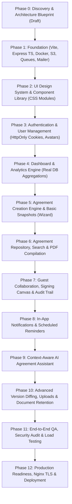

# AGREE2MET — Master Phase-Wise Implementation Roadmap

**Document Version:** 1.0.0  
**Phase:** Phase 0 — Roadmap & Milestone Planning  
**Execution Strategy:** Strict Sequential Phasing with Verification Gates  
**Status:** Draft — Awaiting User Approval  

---

## Roadmap Overview & Execution Principles

Agree2Met will be developed across **13 structured phases (Phase 0 through Phase 12)**. Each phase represents a self-contained, verifiable milestone.

### Core Execution Rules:
1. **Strict Gate Review:** No subsequent phase may commence until all acceptance criteria of the current phase are verified and passing.
2. **Zero "Mock-Only" Drift:** Every feature must connect to real backend endpoints and persist to real database tables.
3. **No Unapproved Styling Frameworks:** Pure CSS and CSS Modules with CSS custom properties (`--color-bg-primary`, etc.) must be used across all components. Tailwind CSS and PostCSS are strictly forbidden.
4. **Interactive Completeness:** Every visible button, modal, dropdown, and tab must possess a functional handler or state transition; decorative non-functional UI elements are strictly disallowed.
5. **No Forward Infrastructure Dependencies:** Foundational storage (S3/MinIO), queuing (BullMQ/Redis), and transactional email services are established in **Phase 1** so that avatar uploads in Phase 3, PDFs in Phase 6, and signature images/invitations in Phase 7 operate on real infrastructure.

---

## Phase Breakdown Matrix

---

## Detailed Phase Specifications

### Phase 0 — Product Discovery, Architecture & Master Planning
- **Status:** **DRAFT — AWAITING USER APPROVAL**
- **Objectives:** Complete system discovery, technology evaluation, relational database design (20 tables), REST API catalogue, security framework, and master roadmap.
- **Scope:** Technical blueprints, ADRs, database specifications, PRDs. No application code or dependencies.
- **Deliverables:**
  - `README.md`
  - `PROJECT_REQUIREMENTS.md`
  - `SYSTEM_ARCHITECTURE.md`
  - `DATABASE_DESIGN.md`
  - `API_DOCUMENTATION.md`
  - `IMPLEMENTATION_ROADMAP.md`
  - `DEVELOPMENT_PROGRESS.md`
  - `TECHNICAL_DECISIONS.md`
- **Acceptance Criteria:** Master documentation approved by stakeholder before Phase 1 code initiation.

---

### Phase 1 — Project Foundation & Development Infrastructure
- **Objectives:** Establish decoupled folder architecture, initialize Vite React frontend and Node.js/Express backend with TypeScript, configure PostgreSQL 16, Redis 7, and MinIO S3 containers in Docker, setup Prisma ORM, initialize S3-compatible storage abstraction, configure BullMQ queues, setup transactional emailer (SMTP/Ethereal local), and verify with a health check endpoint.
- **Scope:**
  - `client/`: Initialize Vite React application, setup directory tree, install React Router DOM, setup CSS modules.
  - `server/`: Initialize Express TypeScript project, configure Pino logger, Prisma client, CORS, Helmet, cookie-parser, CSRF middleware, error handling.
  - **Storage Service (`server/src/services/storage.service.ts`):** MinIO/S3 object storage abstraction layer (putObject, getObject, getSignedUrl, deleteObject) for avatars, PDFs, and signatures.
  - **Queues (`server/src/queues/*.ts`):** Redis-backed BullMQ queue definitions (`pdf-generation-queue`, `transactional-email-queue`, `cron-scheduler-queue`).
  - **Email Service (`server/src/services/email.service.ts`):** Nodemailer transport configured for local SMTP/Ethereal testing with HTML email templates.
  - Infrastructure: `docker-compose.yml` for PostgreSQL 16, Redis 7, and MinIO.
  - Health check endpoint (`GET /api/v1/health`) verifying DB, Redis, and MinIO connections.
- **Files & Components:**
  - `client/package.json`, `client/vite.config.js`, `client/src/main.jsx`, `client/src/App.jsx`
  - `server/package.json`, `server/tsconfig.json`, `server/src/server.ts`, `server/src/app.ts`, `server/src/config/env.ts`
  - `server/src/services/storage.service.ts`, `server/src/services/email.service.ts`, `server/src/queues/index.ts`
  - `docker-compose.yml`, `.env.example`
- **Database Changes:** Initialize Prisma migrations table.
- **API Changes:** `GET /api/v1/health`
- **Security Considerations:** Environment variable validation with Zod; restrict CORS origins; enable Helmet headers; private S3 bucket configuration.
- **Testing Requirements:** Verify Docker spin-up; verify frontend dev server runs on `http://localhost:5173`; verify backend runs on `http://localhost:5000` and `GET /api/v1/health` returns 200 with `{ database: "connected", redis: "connected", storage: "connected" }`. Test storage upload/download and Ethereal email dispatch.
- **Acceptance Criteria:** `npm run dev` in client and server starts cleanly; all infrastructure services operational without errors.

---

### Phase 2 — UI Design System & Frontend Foundation
- **Objectives:** Build custom, dependency-free CSS design system using CSS Modules and CSS custom properties; implement responsive navigation, sidebar, page shells, and core reusable UI components.
- **Scope:**
  - Global CSS tokens (`tokens.css`): Light and dark color palettes, typography scale, elevation shadows, borders, transitions.
  - Theme switching context (`ThemeContext`): Dynamic `data-theme="dark"` attribute toggle with localStorage persistence.
  - Core component library: `Button`, `Input`, `Select`, `Textarea`, `Modal`, `DropdownMenu`, `Card`, `Badge`, `Alert`, `Spinner`, `Tabs`.
  - App Layout: `AppLayout`, `Sidebar` (collapsible, mobile drawer), `Navbar` (user menu, theme toggle, notifications bell), `Breadcrumbs`.
- **Files & Components:**
  - `client/src/styles/tokens.css`, `client/src/styles/global.css`
  - `client/src/components/common/*.jsx` and `*.module.css`
  - `client/src/components/layout/*.jsx` and `*.module.css`
  - `client/src/context/ThemeContext.jsx`
- **Security Considerations:** Accessible contrast ratios meeting WCAG 2.1 AA standards; sanitization of user-provided content.
- **Testing Requirements:** Visual verification of all components in both Light and Dark modes; responsive layout verification on desktop (1440px), tablet (768px), and mobile (375px).
- **Acceptance Criteria:** Design system renders cleanly; theme switches instantly without flicker; sidebar collapses smoothly on mobile.

---

### Phase 3 — Authentication & User Management
- **Objectives:** Complete authentication engine with user registration, login, logout, password recovery, session management, profile editing, avatar upload to S3, and route protection.
- **Scope:**
  - Backend: Password hashing (Argon2id), JWT issue/verification via `HttpOnly` cookies, refresh token rotation with `user_sessions` tracking, hashed verification tokens, CSRF protection.
  - Avatar management utilizing Phase 1 `StorageService` (private S3 storage).
  - Verification & password reset emails dispatched via Phase 1 `EmailService`.
  - Frontend: Registration page, Login page, Forgot Password page, Reset Password page, Profile settings page, Session list/revoke view.
  - AuthContext and custom hook `useAuth()` managing global session state.
  - Route guards: `<ProtectedRoute>` redirecting unauthenticated users to `/login`.
- **Files & Components:**
  - `server/src/api/routes/auth.routes.ts`, `server/src/api/controllers/auth.controller.ts`, `server/src/services/auth.service.ts`
  - `server/src/api/middlewares/auth.middleware.ts`, `server/src/api/middlewares/csrf.middleware.ts`
  - `client/src/pages/auth/*.jsx`, `client/src/context/AuthContext.jsx`, `client/src/services/auth.api.js`
- **Database Changes:** Populate `users`, `user_profiles`, `organizations`, `organization_members`, `user_sessions` tables.
- **Security Considerations:** Tokens exclusively in `HttpOnly`, `SameSite=Strict` cookies; CSRF header validation on mutating requests; brute-force rate limiting.
- **Testing Requirements:** Password hashing tests; login/refresh/logout integration tests; avatar image MIME validation tests; session revocation test.
- **Acceptance Criteria:** Full registration and login cycle works; tokens deliver via cookies only; protected routes block unauthorized access; avatars upload to S3; sessions can be listed and revoked.

---

### Phase 4 — Main Dashboard & Real-Time Analytics
- **Objectives:** Implement executive dashboard displaying real-time metrics, active agreement counters, recent activity stream, upcoming deadlines, and quick actions.
- **Scope:**
  - Backend aggregation service calculating counts for total, active, completed, pending, and expired agreements.
  - Activity feed logging query returning recent events for the active organization.
  - Frontend dashboard page featuring metric KPI cards, dynamic charts (pure SVG / CSS bar charts), recent agreements table, and quick creation action triggers.
- **Files & Components:**
  - `server/src/api/routes/dashboard.routes.ts`, `server/src/services/dashboard.service.ts`
  - `client/src/pages/dashboard/DashboardPage.jsx`, `client/src/components/dashboard/*.jsx`
- **Database Changes:** Query optimization with composite indexes on `agreements(organization_id, status)`.
- **Security Considerations:** Tenant scoping ensures user only sees aggregates for their active organization.
- **Testing Requirements:** Seed test agreements in various states; verify KPI numbers reflect exact database counts.
- **Acceptance Criteria:** Dashboard loads in under 200ms; KPIs match database records; empty states display gracefully for new accounts.

---

### Phase 5 — Agreement Creation Engine & Basic Snapshots
- **Objectives:** Construct interactive multi-stage agreement creation wizard supporting structured clauses, multi-party assignment, financial terms, auto-saving drafts, live preview, and baseline agreement version snapshots.
- **Scope:**
  - 6-Step Guided Flow: 1. Details, 2. Parties, 3. Clauses, 4. Payment Terms, 5. Review & Preview, 6. Dispatch.
  - Re-orderable clause manager with pre-built boilerplate clause library.
  - Multi-party assigner supporting `SIGNER`, `REVIEWER`, `VIEWER` roles and parallel vs sequential signing order.
  - Real-time client-side draft auto-save and backend persistence.
  - **Basic Agreement Versioning:** Automatically captures a baseline snapshot JSON payload in `agreement_versions` upon agreement creation and major draft updates.
- **Files & Components:**
  - `client/src/pages/agreements/AgreementCreatePage.jsx`
  - `client/src/components/agreement/wizard/*.jsx` (StepDetails, StepParties, StepClauses, StepPayment, StepReview)
  - `client/src/components/agreement/AgreementPreview.jsx`
  - `server/src/api/routes/agreement.routes.ts`, `server/src/services/agreement.service.ts`
- **Database Changes:** Insert into `agreements`, `agreement_parties`, `agreement_clauses`, `agreement_payment_terms`, `agreement_versions`.
- **Security Considerations:** Zod validation on backend preventing malformed or cross-tenant party insertion; sanitized clause content.
- **Testing Requirements:** Form validation tests; auto-save test; draft reloading test; version snapshot creation test.
- **Acceptance Criteria:** User can complete all 6 steps, save as draft, reload draft, and transition to `SENT`, with version 1 snapshot recorded.

---

### Phase 6 — Agreement Management, Repository & Document Compilation
- **Objectives:** Build full agreement repository with server-side pagination, full-text search, multi-faceted filtering, detail view tabs, agreement duplication, archival, and server-side PDF compilation using Puppeteer and Phase 1 S3 storage.
- **Scope:**
  - Repository view with status pill filters (Draft, Sent, Awaiting Signatures, Completed, etc.).
  - Search bar with debounced API queries leveraging PostgreSQL full-text search.
  - Detail View Page (`/agreements/:id`) with Document View, Parties Status, Financial Terms, and Chained Audit Log.
  - Duplication and Archive/Unarchive actions.
  - **PDF Compilation Pipeline:** Headless Chromium worker rendering server-sanitized HTML, blocking outbound network calls, running unprivileged with resource constraints, saving to Phase 1 S3 storage, and calculating SHA-256 checksums.
  - Authenticated document streaming download (no tokens in query strings).
- **Files & Components:**
  - `client/src/pages/agreements/AgreementListPage.jsx`, `client/src/pages/agreements/AgreementDetailPage.jsx`
  - `client/src/components/agreement/AgreementTable.jsx`, `client/src/components/agreement/AgreementFilters.jsx`
  - `server/src/services/pdf.service.ts`, `server/src/workers/pdf.worker.ts`
- **Database Changes:** Full-text search index (`idx_agreements_search`), insert into `agreement_documents`.
- **Security Considerations:** Tenant authorization check; Puppeteer SSRF protections; private S3 access.
- **Testing Requirements:** Search accuracy testing; PDF compilation timeout and memory limit tests; tamper-proof checksum verification.
- **Acceptance Criteria:** Repository displays paginated results; search results appear under 100ms; PDF downloads reliably with clean typography.

---

### Phase 7 — Collaboration, Guest Portal & Digital Signing Workflow
- **Objectives:** Implement public, secure guest signing portal, electronic signature canvas (draw, type, upload), electronic consent capture, invitation email dispatch via Phase 1 mailer, and tamper-evident audit hash chaining with row-level serialization.
- **Scope:**
  - Secure tokenized guest route (`/sign/:invitationToken`). Plaintext token transmitted in email link; only SHA-256 hash (`invitation_token_hash`) stored in DB.
  - Explicit electronic consent modal: *"I consent to transact electronically and to apply my electronic signature to this document."*
  - Designed to support basic electronic signature (SES) workflows (with disclaimer that this is not a QES and requires legal counsel).
  - HTML5 Signature Pad supporting Draw, Type, and Upload options (stored in Phase 1 S3).
  - Invitation dispatch and resend using Phase 1 `EmailService`.
  - Backend signing service recording IP, timestamp, user agent, document hash, and chaining the audit event using row-level locks (`SELECT ... FOR UPDATE` on `agreements`).
  - Automatic status transition to `PARTIALLY_SIGNED` or `COMPLETED`.
  - Generation of finalized Certificate of Completion.
- **Files & Components:**
  - `client/src/pages/signing/GuestSigningPage.jsx`, `client/src/components/signing/SignaturePadModal.jsx`
  - `server/src/api/routes/signing.routes.ts`, `server/src/services/signing.service.ts`, `server/src/services/audit.service.ts`
- **Database Changes:** Insert into `signatures`, `audit_events` (`ON DELETE RESTRICT`); update `agreement_parties` and `agreements`.
- **Security Considerations:** Hashed invitation tokens; signature image upload validation; cryptographic SHA-256 event chaining with row lock serialization.
- **Testing Requirements:** Multi-party signing sequence test; decline flow test; tamper-detection verification test on audit hashes.
- **Acceptance Criteria:** External party receives email, signs document, signature appears on PDF, audit trail seals agreement as `COMPLETED`.

---

### Phase 8 — In-App Notifications & Scheduled Reminders
- **Objectives:** Deploy in-app notification center (drawer, badge, read status) and activate scheduled hourly cron worker for deadline tracking and automated reminder emails.
- **Scope:**
  - In-app notification center: real-time badge, mark-as-read, link to agreement.
  - User notification preference management (`GET/PUT /users/notification-preferences`).
  - Scheduled cron worker (using Phase 1 `cron-scheduler-queue`) checking for upcoming deadlines (7d, 3d, 24h) and dispatching reminders via Phase 1 email service.
  - Manual reminder dispatch and cancellation endpoints.
- **Files & Components:**
  - `server/src/workers/cron.worker.ts`, `server/src/services/notification.service.ts`, `server/src/api/routes/notification.routes.ts`
  - `client/src/components/layout/NotificationDrawer.jsx`, `client/src/pages/settings/NotificationPreferencesPage.jsx`
- **Database Changes:** Populate `notifications` and `reminders` tables.
- **Security Considerations:** Email rate limiting to prevent spam; honor user notification preferences.
- **Testing Requirements:** Cron execution simulation; notification read state tests; unsubscribe toggle enforcement.
- **Acceptance Criteria:** In-app notifications update dynamically; reminders fire on schedule based on preferences.

---

### Phase 9 — Context-Aware AI Agreement Assistant
- **Objectives:** Integrate Google Gemini API through backend service layer to assist users with clause drafting, plain English simplification, summarization, and risk review.
- **Scope:**
  - Backend AI service orchestrating Gemini API with structured JSON schemas and strict prompt sandboxing.
  - Frontend AI Assistant drawer accessible from the creation wizard and agreement detail view.
  - Threaded conversation history (`GET/DELETE /ai/conversations`).
  - Capabilities: Clause Drafter, Clause Explainer, Agreement Summarizer, Risk Reviewer.
  - Mandatory legal disclaimer rendered on all AI outputs: *"Disclaimer: Agree2Met AI provides informational assistance only and does not constitute formal legal advice. Consult licensed legal counsel."*
- **Files & Components:**
  - `server/src/services/ai.service.ts`, `server/src/api/routes/ai.routes.ts`
  - `client/src/components/ai/AIAssistantDrawer.jsx`, `client/src/components/ai/ClauseSuggestions.jsx`
- **Database Changes:** Persist to `ai_conversations` and `ai_messages`.
- **Security Considerations:** Zero frontend API key exposure; sanitization of sensitive data; per-tenant rate limits.
- **Testing Requirements:** Mock LLM responses for automated tests; error handling when AI API is unavailable; token limit enforcement.
- **Acceptance Criteria:** AI generates relevant clauses; explainer converts legalese into clear text; disclaimer is prominently displayed.

---

### Phase 10 — Advanced Version Diffing, Uploads & Document Retention
- **Objectives:** Implement advanced visual version diffing between snapshots, supplementary document attachment uploads, document retention policies, and cryptographic integrity verification.
- **Scope:**
  - Visual side-by-side diffing between agreement versions (`GET /agreements/:id/versions`).
  - Supplementary document uploads (PDF, DOCX attachments) with magic-byte MIME validation, file size limits, and S3 storage.
  - Document retention policies: scheduled archival rules for old agreements and compliance enforcement (`ON DELETE RESTRICT` on audited agreements).
  - Cryptographic integrity verification utility checking SHA-256 before serving downloads.
- **Files & Components:**
  - `server/src/services/versioning.service.ts`, `server/src/api/routes/document.routes.ts`
  - `client/src/components/agreement/VersionDiffModal.jsx`, `client/src/components/agreement/AttachmentUploader.jsx`
- **Database Changes:** Insert into `agreement_documents` (`ATTACHMENT` type).
- **Security Considerations:** Magic-byte file validation; private bucket policies; integrity hash verification.
- **Testing Requirements:** Tamper test (modify 1 byte of PDF in storage and verify download fails integrity check); attachment upload validation test.
- **Acceptance Criteria:** Version diffs viewable with visual highlights; attachments upload and download securely; SHA-256 verification confirms document validity.

---

### Phase 11 — Testing, Quality Assurance & Security Hardening
- **Objectives:** Execute comprehensive test suites across unit, integration, and end-to-end layers; conduct security vulnerability scanning, performance benchmarks, and accessibility audits.
- **Scope:**
  - Backend unit & integration tests (Vitest / Supertest) covering Auth, Agreements, State Machine, and Signing.
  - Frontend unit tests for UI components and form validation.
  - End-to-end (E2E) workflow test (Playwright) covering: Register -> Create Agreement -> Send -> Sign as Guest -> Verify Completed PDF.
  - OWASP Top 10 security audit: SQL injection, XSS, CSRF, broken access control.
  - Performance profiling (Lighthouse, k6 API load testing).
- **Files & Components:**
  - `server/tests/**/*.test.ts`, `client/src/**/*.test.jsx`, `e2e/*.spec.ts`
- **Security Considerations:** Complete penetration testing checklist and dependency vulnerability audit (`npm audit`).
- **Testing Requirements:** Minimum 85% test coverage on critical domain services (`AgreementService`, `SigningService`, `AuthService`).
- **Acceptance Criteria:** All test suites pass cleanly; zero high/critical vulnerabilities; p95 latency under 150ms.

---

### Phase 12 — Production Readiness & Deployment Architecture
- **Objectives:** Containerize application using multi-stage Dockerfiles, configure production Nginx reverse proxy with TLS 1.3, setup environment secrets, logging aggregation, and automated database backup strategy.
- **Scope:**
  - Production `Dockerfile` for client (static build served via Nginx).
  - Production `Dockerfile` for server (Node.js Alpine image running compiled JS).
  - `docker-compose.prod.yml` orchestrating API, Client, PostgreSQL, Redis, and Worker containers.
  - Automated database backup script with daily S3 dumps and 30-day retention.
  - Production health monitoring and error logging configuration.
- **Files & Components:**
  - `client/Dockerfile`, `server/Dockerfile`, `nginx/nginx.conf`, `docker-compose.prod.yml`, `scripts/backup-db.sh`
- **Security Considerations:** Strict non-root container users; secrets injected via environment variables; TLS/SSL termination with HTTP/2 and modern ciphers.
- **Testing Requirements:** Staging deployment smoke tests; container restart recovery verification; backup restoration drill.
- **Acceptance Criteria:** Production containers build cleanly; app passes automated smoke tests; backup script restores database with zero data loss.
