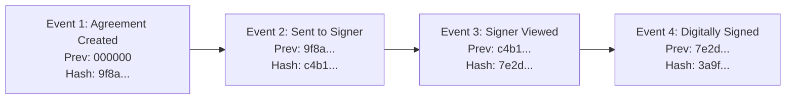
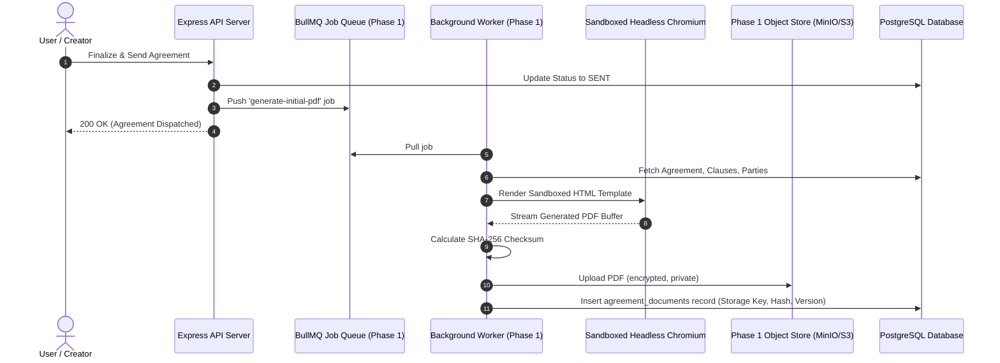

# AGREE2MET — System Architecture & Technical Specifications

**Document Version:** 1.0.0  
**Phase:** Phase 0 — Architecture & System Design  
**Date:** November 2026  
**Status:** Draft — Awaiting User Approval  

---

## 1. Architecture Overview & High-Level System Design

Agree2Met is engineered as a modern, decoupled, multi-tier SaaS platform. The system cleanly separates user presentation from domain orchestration, relational database persistence, asynchronous background processing, and external services.

```mermaid
flowchart TD
    subgraph ClientLayer["Frontend Client Layer (Browser)"]
        SPA["React 18 SPA (Vite + CSS Modules)"]
        State["State / Context / API Clients"]
        SignCanvas["HTML5 Signature Pad"]
    end

    subgraph GatewayLayer["Reverse Proxy & Gateway"]
        Nginx["Nginx / Cloudflare Edge (TLS 1.3, Rate Limit, WAF)"]
    end

    subgraph BackendLayer["Backend Application Layer (Node.js / Express TS)"]
        Router["Express REST API Router (/api/v1)"]
        AuthMid["Auth & Tenant Isolation Middleware"]
        CSRFMid["CSRF & Custom Header Validation"]
        Controllers["Module Controllers"]
        Services["Domain Service Layer (Business Logic)"]
        AuditEngine["Tamper-Evident Audit Trail Engine"]
    end

    subgraph DataLayer["Persistence & Storage Layer"]
        PostgreSQL[("PostgreSQL 16 (Primary ACID Store)")]
        RedisStore[("Redis 7 (Session Cache, Token Store)")]
        S3Storage[("Phase 1 S3 / MinIO Object Store")]
    end

    subgraph WorkerLayer["Asynchronous Worker Layer (BullMQ - Phase 1)"]
        Queue["BullMQ Job Queues"]
        Worker["Background Job Processors"]
        PDFGen["Sandboxed Puppeteer PDF Compiler"]
        EmailService["Phase 1 Mailer (SMTP / Ethereal / Resend)"]
        CronManager["Scheduled Expiration & Reminder Cron"]
    end

    subgraph ExternalLayer["External Services"]
        GeminiAPI["Google Gemini AI API"]
        OAuthGoogle["Google OAuth 2.0 OIDC"]
    end

    SPA -->|HTTPS REST (Cookies Only)| Nginx
    Nginx --> Router
    Router --> AuthMid
    AuthMid --> CSRFMid
    CSRFMid --> Controllers
    Controllers --> Services
    Services --> AuditEngine
    Services --> PostgreSQL
    Services --> RedisStore
    Services --> Queue
    Services --> GeminiAPI
    Services --> OAuthGoogle
    Queue --> Worker
    Worker --> PDFGen
    Worker --> EmailService
    Worker --> CronManager
    PDFGen --> S3Storage
    Services --> S3Storage
```

---

## 2. Technology Stack Evaluation & Selection Rationale

### 2.1 Evaluated Stacks Comparison

| Layer | Option A: Selected Production Stack | Option B: Alternative Node Stack | Option C: Python Hybrid Stack | Evaluation & Decision Rationale |
|---|---|---|---|---|
| **Frontend Framework** | **React.js 18 + Vite (JavaScript)** | Next.js 14 (App Router) | Vue.js 3 + Vite | **React 18 + Vite (JavaScript)** selected. Fast HMR, lightweight SPA bundle, clean client-side state machine management for multi-step agreement creation wizards. Avoids SSR complexity for authenticated SaaS workflows. |
| **Styling Solution** | **CSS Modules + CSS Custom Properties** | Tailwind CSS + PostCSS | Styled-Components (CSS-in-JS) | **CSS Modules** selected per architectural mandate. Zero runtime overhead, 100% standard CSS, modular class isolation, dynamic CSS variables for instant Light/Dark theme switching without Tailwind build lock-in. |
| **Backend Framework** | **Node.js (v20 LTS) + Express.js + TypeScript** | Fastify + TypeScript | Python 3.11 + FastAPI + Pydantic | **Node.js + Express (TS)** selected. Unifies JavaScript ecosystem, mature tooling for PDF processing, streaming downloads, BullMQ integration, and battle-tested middleware ecosystem. Contract validation is enforced via Zod on the backend, paired with matching client-side validation schemas. |
| **Database & ORM** | **PostgreSQL 16 + Prisma ORM** | PostgreSQL 16 + TypeORM | PostgreSQL 16 + SQLAlchemy | **PostgreSQL + Prisma** selected. PostgreSQL provides relational consistency, JSONB support, and full-text search. Prisma provides end-to-end type safety, automated migrations, and high developer velocity. |
| **Storage & Queues (Phase 1)** | **S3-Compatible Storage (MinIO/S3) + Redis 7 + BullMQ** | Local Disk + RabbitMQ | Local Disk + Celery | **Provisioned in Phase 1.** Establishes foundational storage and queue infrastructure early so Phase 3 (avatars), Phase 6 (PDFs), and Phase 7 (signatures, invitation emails) have reliable infrastructure without forward dependencies. |
| **PDF Generation Engine** | **Puppeteer Headless Chrome + pdf-lib** | Client-side jsPDF | WeasyPrint (Python/C) | **Puppeteer + pdf-lib** selected. Ensures pixel-perfect document rendering matching web typography, reliable header/footer page numbering, and dynamic signature stamping. Sandboxed and worker-isolated. |
| **AI Integration** | **Google Gemini API (Server-Mediated)** | OpenAI API (Direct) | Local Ollama Model | **Google Gemini API** selected for high-throughput, structured JSON output mode, large context window for legal agreements, and cost-efficient execution. Server-side mediation ensures zero API key exposure. |

---

## 3. Layered Architectural Decomposition

Agree2Met enforces a clean **Four-Tier Architecture** with strict boundary separation:

### 3.1 Presentation Tier (`client/`)
- **Routing:** `react-router-dom` v6 with protected route guards (`<ProtectedRoute>`, `<GuestOnlyRoute>`, `<TenantBoundary>`).
- **State Management:** React Context API + custom hooks (`useAuth`, `useAgreement`, `useTheme`, `useNotification`) for global app state; local component state for transient form data.
- **Styling Architecture:** Design tokens defined in root `:root` and `[data-theme="dark"]` CSS variables (`--color-bg-primary`, `--color-accent`, `--font-primary`, `--radius-md`). Component-specific styling strictly within `*.module.css` files.
- **Design Principles:** Desktop-first with full tablet and mobile responsiveness; zero empty or non-functional visual placeholders.

### 3.2 API & Controller Tier (`server/src/api/`)
- **API Versioning:** Strict URL version prefixing (`/api/v1/*`).
- **Middleware Pipeline:**
  1. `helmet`: Secure HTTP headers (CSP, HSTS, X-Content-Type-Options).
  2. `cors`: Strict origin whitelisting with credential support (`credentials: true`).
  3. `rateLimiter`: IP and user-based token bucket rate limiting via Redis.
  4. `cookieParser`: Parsing secure HTTP-only cookies.
  5. `authenticate`: JWT verification from `HttpOnly` cookie and user identity extraction.
  6. `csrfProtection`: Custom header validation (`X-Requested-With: XMLHttpRequest`) and double-submit CSRF cookie check on mutating requests (`POST`, `PUT`, `PATCH`, `DELETE`).
  7. `authorize`: Organization and role-based permissions (`RBAC`).
  8. `validate(schema)`: Request body and query validation using Zod.
- **Controller Responsibilities:** Request unpacking, schema validation, invoking domain services, and returning standardized JSON responses. Tokens are never returned in JSON bodies.

### 3.3 Domain Service Tier (`server/src/services/`)
- Contains pure business logic independent of HTTP protocols.
- **Key Services:**
  - `AuthService`: Authentication, password hashing (Argon2id), hashed token generation, session management.
  - `StorageService` *(Phase 1)*: S3-compatible object storage abstraction for avatars, PDFs, and signature images.
  - `EmailService` *(Phase 1)*: Transactional email dispatcher (SMTP/Ethereal local, Resend/SES prod).
  - `AgreementService`: Agreement creation, cloning, draft auto-save, basic version snapshots (Phase 5), state machine transitions.
  - `SigningService`: Invitation verification, signature capture, consent recording, seal generation.
  - `AuditService`: Tamper-evident event recording with SHA-256 hash chaining and row-level lock serialization.
  - `DocumentService`: Storage abstraction, PDF compilation trigger, integrity checksum calculation.
  - `NotificationService`: In-app notification creation, transactional email queuing.
  - `AIService`: Contextual prompt engineering, Gemini API communication, output sanitization.

### 3.4 Data Access & Persistence Tier (`server/src/prisma/`)
- Relational schema managed exclusively through Prisma Schema (`schema.prisma`).
- Database migrations tracked via `prisma migrate dev` and applied in production with `prisma migrate deploy`.
- Connection pooling configured for high concurrency.

---

## 4. Security & Cryptographic Architecture

### 4.1 Authentication, Session Management & CSRF Strategy
- **Password Security:** Passwords hashed using **Argon2id** (memory cost: 64MB, time cost: 3 iterations, parallelism: 4 threads).
- **Token Delivery Exclusively via HttpOnly Cookies:**
  - *Access Token:* Stateless JWT, 15-minute lifespan. Stored in `jwt_access` cookie (`HttpOnly`, `Secure`, `SameSite=Strict`). Never returned in JSON bodies. Browser clients do not use Bearer headers.
  - *Refresh Token:* Stateful 256-bit cryptographic random string, 7-day lifespan. Stored in `jwt_refresh` cookie (`HttpOnly`, `Secure`, `SameSite=Strict`). Stored in database table `user_sessions` strictly as a **SHA-256 hash (`refresh_token_hash`)**. Rotated on every refresh call.
  - Tokens are never exposed to client-side JavaScript, eliminating token exfiltration via Cross-Site Scripting (XSS).
- **CSRF Defense Strategy:**
  - For all mutating HTTP requests (`POST`, `PUT`, `PATCH`, `DELETE`), the backend requires the custom header `X-Requested-With: XMLHttpRequest` and validates a double-submit CSRF cookie (`X-CSRF-Token`). Browsers do not attach custom headers to cross-origin requests without an explicit CORS preflight check that respects origin whitelisting.
- **SameSite Deployment Assumptions:**
  - The client application (`app.agree2met.com`) and API (`api.agree2met.com`) share a parent same-site domain (`agree2met.com`), allowing `SameSite=Strict` or `SameSite=Lax` cookies to be transmitted reliably.
- **Handling of Email Deep Links:**
  - Deep links sent in transactional emails (e.g. `/sign/:token`, `/verify-email?token=...`, or password reset links) target top-level browser navigation to the frontend SPA route (e.g. `https://app.agree2met.com/sign/:token`).
  - Standard top-level GET navigations load the client application bundle cleanly. The client SPA then issues same-origin/same-site API calls containing custom CSRF headers to validate the token.
  - Plaintext tokens in deep links are hashed with SHA-256 on the backend before database comparison.

### 4.2 Multi-Tenant Data Isolation
- Organizations relate to users exclusively through `organization_members`.
- Every core entity (`agreements`, `documents`, `templates`) possesses an `organization_id` foreign key.
- Authorization middleware injects active `tenantContext` into the request scope.
- Database queries are automatically wrapped with tenant scoping filters:
  ```typescript
  // Service layer invariant
  const agreement = await prisma.agreement.findFirst({
    where: {
      id: agreementId,
      organizationId: req.tenantContext.organizationId,
    },
  });
  ```

### 4.3 Tamper-Evident Cryptographic Audit Trail
To ensure accountability and document integrity, Agree2Met implements **Tamper-Evident Cryptographic Hash Chaining** across all audit events for an agreement:
1. When an event occurs (e.g., `CREATED`, `VIEWED`, `SIGNED`), the event payload is structured.
2. The `previous_event_hash` is fetched from the latest audit record for that agreement.
3. The new event's hash is computed:
   $$\text{EventHash} = \text{SHA256}(\text{AgreementID} + \text{Timestamp} + \text{EventType} + \text{ActorEmail} + \text{IPAddress} + \text{PreviousEventHash})$$



#### Important Technical Nuances & Limitations:
- **Tamper-Evident, Not Tamper-Proof:** Hash chaining makes unauthorized tampering readily detectable. However, an actor with direct, unrestricted write access to the PostgreSQL database could theoretically recompute and overwrite the entire chain.
- **Per-Agreement Serialization:** To prevent concurrent signing actions from creating conflicting branches (chain forks), event creation acquires a row-level lock on the agreement record (`SELECT id FROM agreements WHERE id = $1 FOR UPDATE`) within a Prisma interactive transaction.
- **Audit Immutability & Retention:** `audit_events.agreement_id` is configured with `ON DELETE RESTRICT` (not CASCADE). Agreements associated with audit events cannot be hard-deleted from the database; they must be archived. This ensures compliance with audit retention policies.
- **Future Hardening Option:** Architecture supports optional periodic external anchoring of the latest agreement hash (e.g., publishing hash digests to an RFC 3161 Timestamping Authority or external append-only log).

---

## 5. Electronic Signature Legal Model

### 5.1 Legal Characterization & Disclaimers
- Agree2Met is **designed to support basic electronic signature (SES) workflows**.
- **Not a Qualified Electronic Signature (QES):** Agree2Met does not issue certificate-based digital signatures or Qualified Electronic Signatures under EU eIDAS or accredited Trust Service Provider schemes.
- **No Statutory Compliance Claim:** The platform does not claim statutory legal validity under the US ESIGN Act, UETA, EU eIDAS, or other jurisdiction-specific laws.
- **Mandatory Legal Counsel Notice:** Legal validity, admissibility, and enforceability depend on jurisdiction, agreement subject matter, process integrity, and case-specific factors. Users must have agreements and workflows reviewed by qualified legal counsel.

### 5.2 Electronic Consent & Process Requirements:
1. **Affirmative Electronic Consent:** Signers must check an explicit confirmation before accessing the signature canvas:
   > *"I consent to transact electronically and to apply my electronic signature to this document."*
2. **Intent to Sign:** Explicit button action labeled "Sign & Complete Agreement".
3. **Association of Signature with Document:** The signature visual and cryptographic record are bound to the specific document version hash.
4. **Certificate of Completion:** Automatically produced upon final signature, containing document checksum, audit timeline, IP addresses, and timestamps.
5. **Document Retention & Access:** All signatories receive direct email access to download the executed PDF.

---

## 6. Document Generation & Puppeteer Security Architecture



### 6.1 Puppeteer PDF Worker Security Hardening
To eliminate Server-Side Request Forgery (SSRF), local file read vulnerabilities, and denial-of-service risks during PDF generation, the Puppeteer worker must adhere to four mandatory security constraints:
1. **Render Only Server-Sanitized HTML:** HTML templates must use strict template escaping. User-provided clause text is sanitized and rendered strictly as text nodes; raw user HTML or embedded `<script>` execution is strictly forbidden.
2. **Block All Outbound Network Requests:** Puppeteer request interception (`page.setRequestInterception(true)`) must abort all external HTTP/HTTPS requests, data URIs, and resource loads. All fonts, styles, and vector assets must be bundled locally.
3. **Run Unprivileged in Sandbox:** Chromium processes must execute under a dedicated, unprivileged non-root OS user in the container with standard Chrome sandbox flags enabled (`--no-sandbox` is prohibited in production).
4. **Resource Constraints:** Enforce strict execution timeouts (maximum 10 seconds per document) and worker memory limits (maximum 512MB per process) to neutralize infinite rendering loops or complex DOM DoS attacks.

---

## 7. Background Processing & Infrastructure (Phase 1 Foundation)

Foundational storage and asynchronous workers are initialized in **Phase 1** to provide underlying infrastructure for all subsequent phases:

| Queue / Resource | Purpose | Initialized In | Used In |
|---|---|---|---|
| **S3 Storage (MinIO/S3)** | Object storage for avatars, compiled PDFs, and signature images. | **Phase 1** | Phase 3 (avatars), Phase 6 (PDFs), Phase 7 (signatures), Phase 10 (uploads) |
| `transactional-email-queue` | Dispatches invitation emails, OTPs, signature notices, and reset links. | **Phase 1** | Phase 3 (verifications), Phase 7 (invites), Phase 8 (reminders) |
| `pdf-generation-queue` | Compiles HTML agreement templates into high-res PDF documents. | **Phase 1** | Phase 5 (draft preview), Phase 6 (repository PDFs), Phase 7 (final sealed PDF) |
| `cron-scheduler-queue` | Scans for agreements approaching expiration (7d, 3d, 24h) and sends reminders. | **Phase 1** | Phase 8 (scheduled reminder engine) |
| `ai-processing-queue` | Asynchronous processing of document summarization and clause reviews. | **Phase 1** | Phase 9 (AI assistant) |

---

## 8. Frontend & Backend Directory Architecture

```
Agree2Met/
├── client/                     # Frontend Application (React 18 + JavaScript + Vite)
│   ├── public/                 # Static assets, favicon, web manifest
│   ├── src/
│   │   ├── assets/             # Images, vector icons, illustrations
│   │   ├── components/         # Reusable UI components
│   │   │   ├── common/         # Button, Input, Modal, Dropdown, Table, Card, Badge, Alert
│   │   │   ├── layout/         # Navbar, Sidebar, PageContainer, Header, Footer
│   │   │   ├── agreement/      # StepWizard, ClauseEditor, PartySelector, PreviewPane, SignatureModal
│   │   │   ├── dashboard/      # StatCard, ActivityFeed, QuickActions, AnalyticsChart
│   │   │   └── ai/             # AIAssistantDrawer, ClauseSuggestions, SummarizerModal
│   │   ├── context/            # React Contexts (AuthContext, ThemeContext, NotificationContext)
│   │   ├── hooks/              # Custom hooks (useAuth, useDebounce, useSignaturePad, useFetch)
│   │   ├── pages/              # Route views (auth, dashboard, agreements, signing, settings)
│   │   ├── services/           # HTTP API client modules (auth.api, agreements.api, ai.api)
│   │   ├── styles/             # Global CSS tokens, resets, utility classes
│   │   │   ├── tokens.css      # CSS variables for themes (Light/Dark), spacing, typography
│   │   │   ├── reset.css       # Standard CSS normalization
│   │   │   └── global.css      # App-wide global baseline styles
│   │   ├── utils/              # Formatting helpers, date tools, validation helpers
│   │   ├── App.jsx             # Root router and layout container
│   │   └── main.jsx            # Entry point
│   ├── index.html
│   ├── package.json
│   └── vite.config.js
│
├── server/                     # Backend Application (Node.js + Express + TypeScript)
│   ├── prisma/
│   │   ├── schema.prisma       # Relational database schema definition (20 tables)
│   │   ├── migrations/         # Timestamped SQL migration history
│   │   └── seed.ts             # Development and test seed scripts
│   ├── src/
│   │   ├── api/                # HTTP layer (controllers, middlewares, routes, validators)
│   │   ├── config/             # Environment, Database, Redis, S3, Email configurations
│   │   ├── constants/          # Status enums, role definitions, system constants
│   │   ├── errors/             # Custom AppError classes (BadRequest, Unauthorized, NotFound)
│   │   ├── queues/             # BullMQ queue definitions (Phase 1)
│   │   ├── services/           # Domain business logic (Auth, Storage, Email, Agreement, Signing, AI)
│   │   ├── types/              # Backend TypeScript types and Express augmentation
│   │   ├── utils/              # Crypto tools, logger (Pino), hash generators, formatters
│   │   ├── workers/            # BullMQ background job consumers (PDF, Email, Cron)
│   │   ├── app.ts              # Express application factory
│   │   └── server.ts           # HTTP server listener and graceful shutdown
│   ├── tests/                  # Unit, Integration, and E2E test suites
│   ├── package.json
│   └── tsconfig.json
│
├── docker-compose.yml          # Local containerization (PostgreSQL 16, Redis 7, MinIO S3)
└── [Documentation Files]       # Root planning and architecture specifications
```
